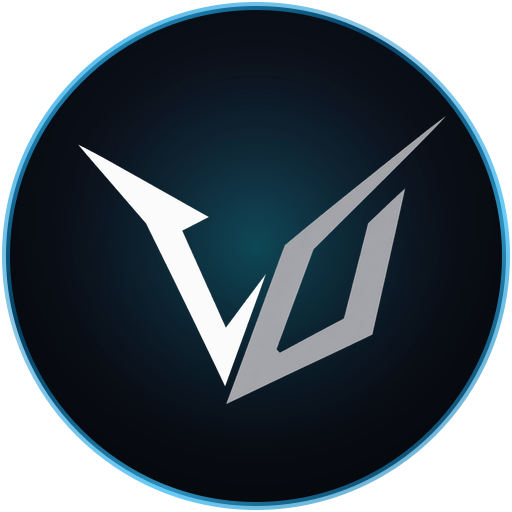

<div align="center">
  
  <h1>⚔️ Valdora Universe Web Portal</h1>
  <p><strong>Official Web Portal & Live Services for Valdora Universe Minecraft 1.21.x Survival RPG Indonesia</strong></p>

  <p>
    <a href="https://valdora.my.id/"></a>
    <a href="https://discord.gg/"></a>
    
    
  </p>
</div>

---

## 🌌 Overview

**Valdora Universe Web** adalah portal interaktif modern untuk server Minecraft RPG Indonesia. Portal ini mengintegrasikan live telemetry Minecraft server, sistem otentikasi pemain (nLogin / AuthMe), dashboard statistik AuraSkills & BattlePass, galeri komunitas Discord, serta streaming media otomatis dari YouTube & TikTok.

---

## ✨ Fitur Utama

- 🎮 **Live Server Telemetry**: Status real-time server Minecraft (online/offline, player count, MOTD, latency).
- 🔴 **Live & Media Cinema Hub**: Sinkronisasi otomatis konten live streaming & kreasi video dari channel Discord `#share-media` dengan Cinema Player 16:9 dan grid responsif.
- 📸 **Discord Gallery Integration**: Galeri screenshot gameplay yang disinkronisasi langsung dari channel Discord media.
- 🛡️ **Sistem Ras & RPG Lore**: Showcase 4 ras utama (Human, Elf, Orc, Undead) dengan stats visual dan lore interaktif.
- ⚔️ **AuraSkills & Player Rankings**: Leaderboard pemain dan rincian kemampuan RPG.
- 🔐 **Pemain Dashboard**: Login aman dengan enkripsi sesi JWT dan integrasi database nLogin.
- 💎 **Optimasi SEO & Favicon Google**: Standar Google Search Central dengan schema structured data Schema.org (`Organization`, `WebSite`) dan multi-resolution favicon suite.

---

## 🛠️ Tech Stack

- **Frontend**: React 18, Vite 6, Modern Vanilla CSS (Dark Obsidian Palette, Glassmorphism, Micro-animations)
- **Backend / API**: Express 5, Node.js standalone bundle (Esbuild ESM), RESTful APIs
- **Database / Sync**: MySQL / MariaDB (nLogin Auth), Discord REST API Sync
- **Deployment**: Headless Linux container on Pterodactyl with Skript lifecycle automation (`/web`)

---

## 🚀 Menjalankan Secara Lokal

### 1. Kloning Repository
```bash
git clone https://github.com/hamdan-sgpt/valdora-web.git
cd valdora-web
```

### 2. Pasang Dependencies
```bash
npm install
```

### 3. Konfigurasi Environment
Salin `.env.example` menjadi `.env` lalu sesuaikan kredensial:
```bash
cp .env.example .env
```

### 4. Jalankan Dev Server
```bash
npm run dev
```
Buka browser pada `http://localhost:5173`.

### 5. Build Produksi
```bash
npm run build
```

---

<div align="center">
  <p>© 2026 <strong>Valdora Universe</strong>. Dibuat dengan penuh dedikasi untuk komunitas Minecraft Indonesia.</p>
</div>
